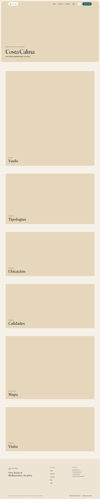
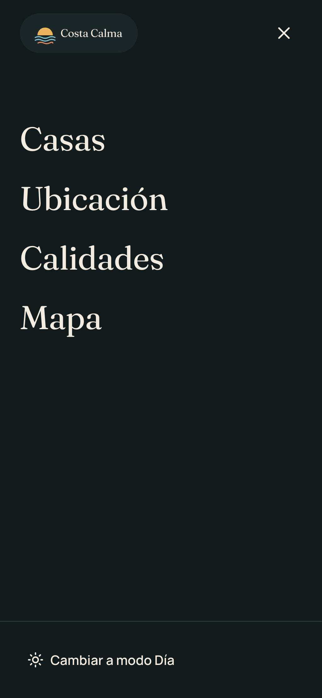
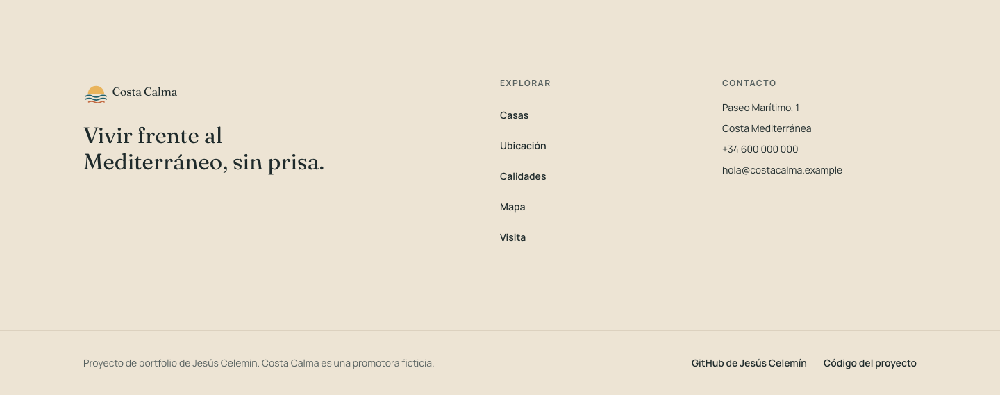
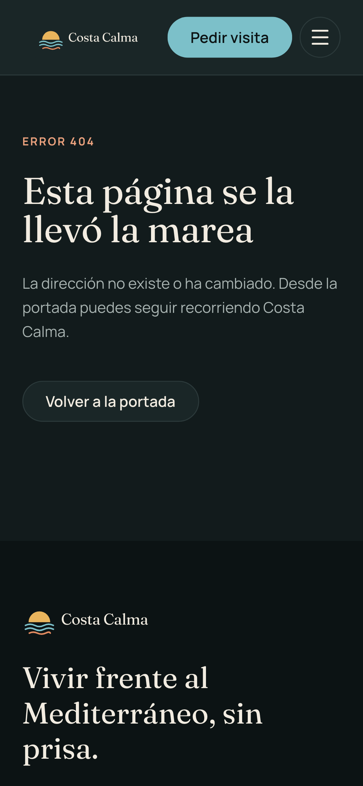
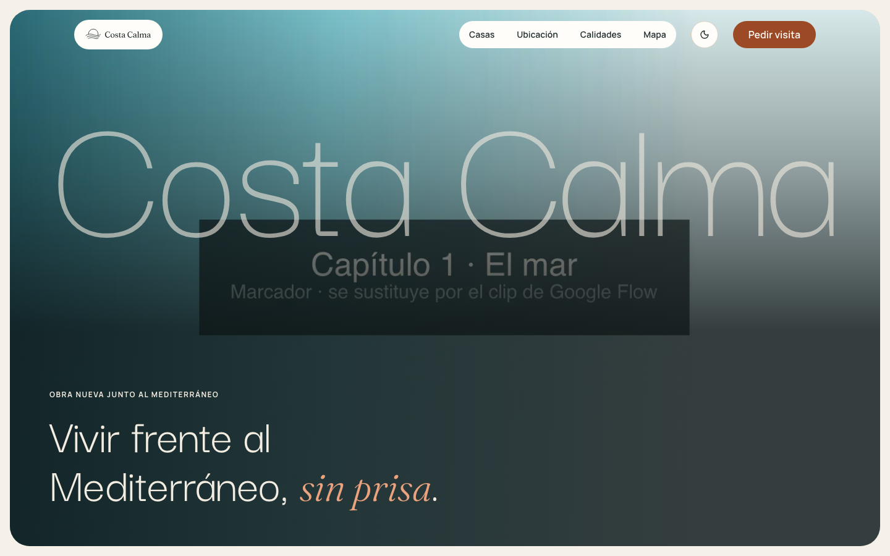
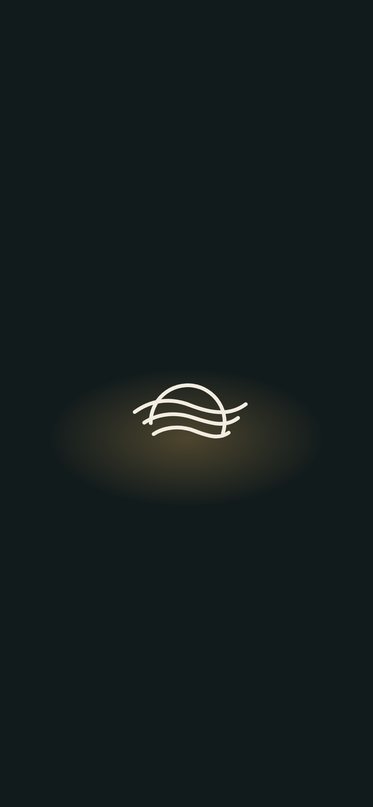
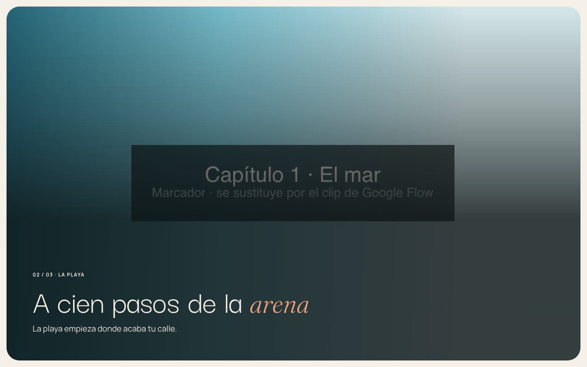
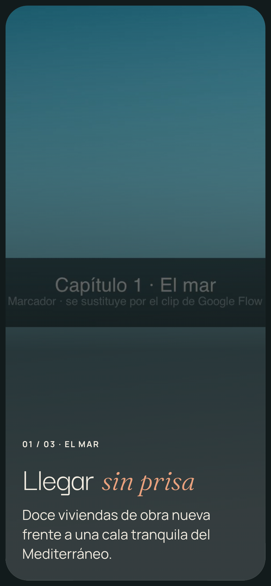
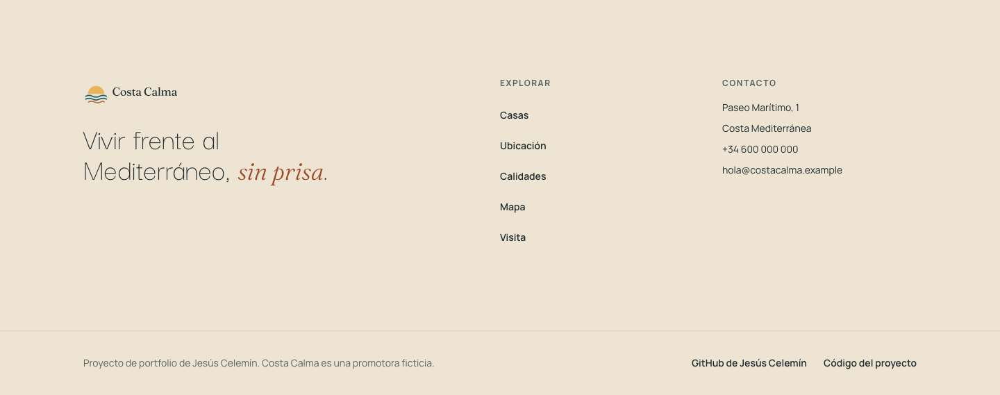
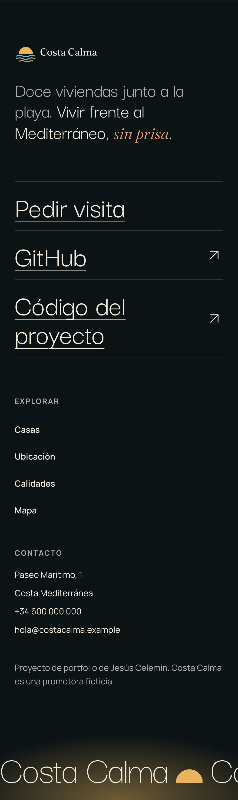

# Costa Calma

Portfolio project: a cinematic, scroll-driven website for a fictional developer selling new-build homes in a small development by a Mediterranean beach. The interface is in Spanish (Spain).

Work in progress. Screenshots, demo and technical write-up will be added as the phases land.

## Development

```bash
npm install
npm run dev          # http://localhost:3000
npm run check        # lint, format, types, Vitest unit tests and Playwright E2E
npm run test         # Vitest unit tests only (pure logic, src/**/*.test.ts)
npm run screenshots  # review captures into docs/screenshots/phase-2 (desktop and mobile, Día and Noche)
npm run media:flight # rebuild the flight videos, stills and manifest (needs ffmpeg)
```

The flight videos in `public/media/flight/` are placeholders drawn from the brand palette, with the same all-keyframe H.264 and VP9 encoding the Google Flow clips will get. `npm run media:flight -- --from <dir>` runs the real clips through the same pipeline; see [docs/media/flight.md](docs/media/flight.md) for the shot list, the Flow prompts and the encoding.

## Phase 1: project base

Brand tokens, fonts, logo, header, mobile menu, Día/Noche theme, footer and the brand 404, error and loading pages. The landing sections are still placeholders.

| Desktop · Día                                                         | Mobile · Noche                                                 |
| --------------------------------------------------------------------- | -------------------------------------------------------------- |
|  |  |
|    |   |

All captures, at 1440×900 and 390×844 in both themes, are in [`docs/screenshots/phase-1`](docs/screenshots/phase-1).

### Design sources and tools

- **Header and footer references.** Both come from the Costa Calma design system (palette, type scale, logo guide), not from outside references. The logo guide asks for the logo to sit on a light pill over imagery, which shaped the transparent header over the hero that turns into a solid panel after it. The footer follows the same system: `surface-sunken`, the tagline in Fraunces and a clear portfolio notice.
- **shadcn/ui and Radix:** `Button` and `Sheet` (the full-screen mobile menu), re-themed to the brand tokens, radii and motion. Radix provides the focus trap, Esc to close and focus return.
- **next-themes:** Día/Noche follows the system, remembers the choice and applies it before the first paint without reading cookies, so the landing stays static.
- **Lucide:** the only icon set.
- **Playwright and axe-core:** E2E tests for every flow, plus a WCAG 2.1 AA audit (including text contrast) of the landing, the mobile menu and the 404 in both themes, a full keyboard pass, and the review captures (no console errors, broken images or horizontal overflow).
- **ui-ux-pro-max:** final usability and accessibility review of the phase.
- **Matt Pocock's skills** (grilling, domain-modeling, tdd, implement, code-review, pr) for the spec → tickets → test-first workflow.

The project also plans to use frontend-design, 21st.dev, Mobbin and motionsites. Phase 1 used none of them: its tickets arrived with the design already fixed by the design system. They come in with the cinematic sections from Phase 2 onwards.

### Review fixes

The final review of Phase 1 found and fixed:

- The button focus ring faded in over 550 ms, and its offset was painted in the page colour even on other surfaces. Buttons now use the same instant 2px `mar` outline as links.
- The mobile menu still animated with `prefers-reduced-motion`.
- Buttons showed an arrow cursor instead of a pointer.
- The 404 lost the site header and footer. It now keeps both and still answers with a 404 status.
- With the menu open, widening the window to the desktop header left it open and impossible to close by pointer.
- The loading pulse ran at 2 s, outside the brand's 400–700 ms motion range.

Reviewed and kept on purpose:

- **No active-section highlight in the header yet.** Every section is still a placeholder, and the flight (Phase 2) changes their geometry, so the highlight waits for the real sections.
- **The footer phone and email are plain text, not `tel:`/`mailto:` links.** The contact details are fictitious.
- **The menu links carry `type="button"`.** Radix `SheetClose asChild` adds it. On `<a>` it is only a MIME hint, browsers ignore it, and axe does not flag it.
- **The header and footer have separate link styles.** The header uses a padded pill hover. The footer uses a colour hover aligned to its column edge.
- **The admin area has no `loading` or `error` page yet.** Both arrive with its first page in Phase 5.
- **The error and loading pages have no automated audit of their own.** They are hard to trigger from E2E, but they use the same `StatusScreen` and `Logo` with the same tokens that the 404 audit checks.

## Phase 2: arriving at the coast

The first stretch of the story: a loading intro with the logo's sun rising over the waves, a full-screen hero, a scroll-driven flight from the sea to the development in three chapters, a new display typeface and a new footer. Every moving part has a still alternative for `prefers-reduced-motion`, slow connections and data saving.

| Desktop · Día                                                               | Mobile · Noche                                                                   |
| --------------------------------------------------------------------------- | -------------------------------------------------------------------------------- |
|              |  |
|  |          |
|          |               |

All captures, at 1440×900 and 390×844 in both themes, are in [`docs/screenshots/phase-2`](docs/screenshots/phase-2). The flight still runs on placeholder clips drawn from the brand palette; the Google Flow footage replaces them through the same pipeline.

### The scrub engine

The flight is driven by `useScrub` ([`src/lib/scrub`](src/lib/scrub)), an engine written for the project instead of wrapping scroll-world's `scrub-engine.js` ([ADR 0003](docs/adr/0003-own-scrub-engine.md)). It borrows scroll-world's techniques and keeps them typed and tested:

- **A pure timeline.** `timelineAt(progress, chapters, hold)` turns the section's scroll progress (0–1) into the clip time, the active chapter and how far through it the reader is. Each chapter gets a share of the scroll as long as its share of the clip, so the camera keeps one pace, and holds on its middle frame for part of its scroll so its text can be read. It has no DOM and is unit-tested with Vitest.
- **A seek-ready clip.** The video is fetched whole as a Blob, so seeking never waits on the network, and it is encoded with every frame a keyframe (H.264, with a VP9 WebM fallback), so any `currentTime` decodes at once. A Node pipeline (`npm run media:flight`, [docs/media/flight.md](docs/media/flight.md)) builds both formats, the stills and a Zod-validated manifest within a size budget (4 MB desktop, 2.5 MB mobile).
- **Eased scroll.** On each animation frame, while the section is on screen, the engine eases towards the real scroll position, so a jumpy wheel or trackpad still moves the camera smoothly. It skips seeks smaller than a frame, and it lands cleanly after the reader leaves.
- **CSS does the copy.** The engine only writes `--chapter-progress` and the active chapter. Each chapter's text fades and rises with pure CSS from that variable, so nothing re-renders per frame.
- **Graceful failure.** If the clip errors, does not start arriving in time, cannot be decoded, or the visitor asked for reduced motion or saves data, the clip is never used and the same scroll moves through one still per chapter with fades. Phones get their own vertical clip and a shorter flight.

The same engine will drive the room-by-room house tours in Phase 4.

### Design sources and tools

- **Jesús's references.** The [Vesper](https://www.youtube.com/watch?v=GJxchJkk4Lk) cabin demo built with scroll-world inspired the flight (a drone shot from outside into the scene, chapters with a counter, eyebrow and short title) and the giant translucent wordmark over the hero. [macnaagroup.com](https://macnaagroup.com/) inspired the type (a huge light grotesk with italic serif accent words), words rising from line masks, and the footer: the statement beside small details, underlined links and a marquee of the place name over a warm sunset glow. Both shaped patterns, never the palette: the brand tokens stay.
- **Darker Grotesque, Fraunces italic and Manrope** ([ADR 0002](docs/adr/0002-darker-grotesque-display-type.md)) give the editorial display type, with an orange accent word in each title.
- **GSAP and Lenis:** smooth scroll on GSAP's ticker, and SplitText for the word-by-word titles. The rest of the motion is CSS, including the footer's scroll-driven rise (`animation-timeline: view()`), which needs no JavaScript.
- **ffmpeg and sharp** for the media pipeline, and **Zod** for the sequence manifests.
- **Playwright and axe-core:** E2E tests for every flow. A WCAG 2.1 AA audit covers the intro, the hero, each flight chapter (with its still and with the clip), the footer and the mobile menu in both themes. There is also a full keyboard pass, and the review captures check for console errors, broken images and horizontal overflow.
- **Firecrawl** to capture macnaagroup.com's footer as a reference during the footer redesign.
- **ui-ux-pro-max:** final usability and accessibility review of the phase (below).

Mid-phase, Jesús replaced the logo with a single-color line drawing (a sun setting behind three waves) and made orange the action color instead of blue ([ADR 0004](docs/adr/0004-orange-action-color.md)). The Open Graph image was redrawn to match.

### Review fixes

The final review of Phase 2 found and fixed:

- The footer marquee moved on its own with no way to stop it apart from reduced motion. It now also pauses under the pointer.
- The loading intro had no accessibility audit, and the footer was audited before its statement had entered, so axe skipped the hidden text. Both now have their own audits in Día and Noche, and the intro gets the console and overflow checks too.

Reviewed and kept on purpose:

- **The marquee has no pause button.** It is decorative and hidden from assistive technology, it stops completely with reduced motion and pauses under the pointer, and it only shows at the very end of the page. A button would add a Tab stop that controls nothing a screen reader user can perceive.
- **The hero and flight images have empty `alt`.** For now they are placeholders: describing the sea and the beach would describe images that are not there. The meaning is carried by the motto and each chapter's heading. Real descriptions come with the Google Flow assets.
- **The intro holds the page for up to 2.5 s.** That is the spec: it lasts as long as the real preload, it announces itself as a status ("Cargando Costa Calma…"), and it only plays once per session and only on the landing. With reduced motion it only fades, and without JavaScript it never shows.
- **The flight pins a long section.** It uses the page's own scroll (nothing is hijacked), keyboard users get "Saltar el vuelo", and reduced motion shows the stills. Phones get a shorter flight.
- **The footer's portfolio links read "GitHub" and "Código del proyecto".** Their names say where they lead within the footer, as the spec asks.
