# Costa Calma

Portfolio project: a cinematic, scroll-driven website for a fictional developer selling new-build homes in a small development by a Mediterranean beach. The interface is in Spanish (Spain).

Work in progress: Phases 1 and 2 are done (below). A demo video comes with the deployment in Phase 6.

## Development

```bash
npm install
npm run dev          # http://localhost:3000
npm run check        # lint, format, types, Vitest unit tests and Playwright E2E
npm run test         # Vitest unit tests only (pure logic, src/**/*.test.ts)
npm run screenshots  # review captures into docs/screenshots/phase-2 (desktop and mobile, Día and Noche)
npm run media:flight # rebuild the flight videos, stills and manifest (needs ffmpeg)
npm run media:furniture # rebuild the house models' furniture, its manifest and its credits
```

The flight videos in `public/media/flight/` are placeholders drawn from the brand palette, with the same all-keyframe H.264 and VP9 encoding the Google Flow clips will get. `npm run media:flight -- --from <dir>` runs the real clips through the same pipeline; see [docs/media/flight.md](docs/media/flight.md) for the shot list, the Flow prompts and the encoding.

The furniture in the house models is third-party glTF ([ADR 0007](docs/adr/0007-third-party-3d-assets.md), [ADR 0011](docs/adr/0011-textured-furniture.md)). The originals stay out of the repository, in `assets-src/`. `npm run media:furniture` downloads the Poly Haven pieces into it and takes any piece left there by hand. It simplifies each one, cuts its textures down to WebP (one `.glb` for desktop, a lighter one for mobile) and compresses it with meshopt. It then writes the Zod-checked manifest the plans' furniture is validated against. The origin and licence of every piece are in [docs/credits.md](docs/credits.md).

## Phase 1: project base

Brand tokens, fonts, logo, header, mobile menu, Día/Noche theme, footer and the brand 404, error and loading pages. The landing sections are still placeholders.

| Desktop · Día                                                         | Mobile · Noche                                                 |
| --------------------------------------------------------------------- | -------------------------------------------------------------- |
| 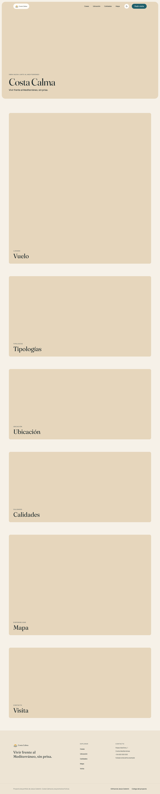 | 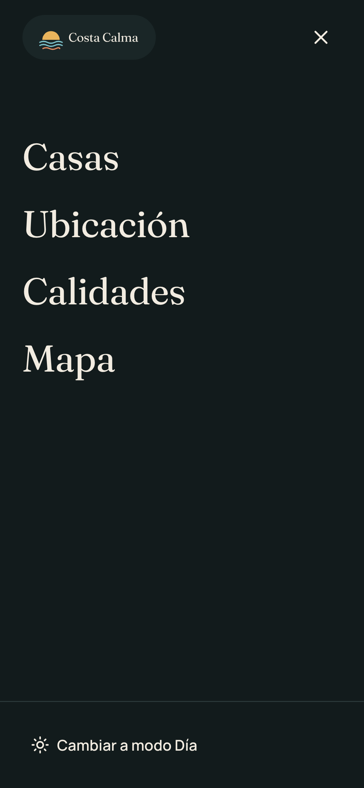 |
| 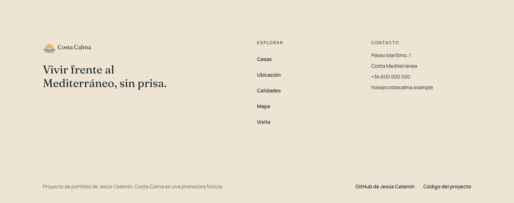   | 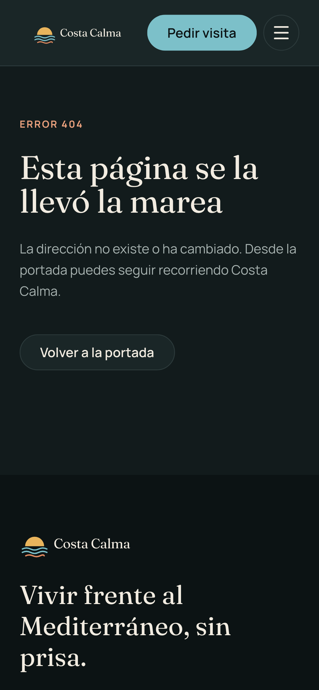  |

All captures, at 1440×900 and 390×844 in both themes, are in [`docs/screenshots/phase-1`](docs/screenshots/phase-1).

### Design sources and tools

- **Header and footer references.** Both come from the Costa Calma design system (palette, type scale, logo guide), not from outside references. The logo guide asks for the logo to sit on a light pill over imagery, which shaped the transparent header over the hero that turns into a solid panel after it. The footer follows the same system: `surface-sunken`, the tagline in the display face and a clear portfolio notice.
- **shadcn/ui and Radix:** `Button` and `Sheet` (the full-screen mobile menu), re-themed to the brand tokens, radii and motion. Radix provides the focus trap, Esc to close and focus return.
- **next-themes:** Día/Noche follows the system, remembers the choice and applies it before the first paint without reading cookies, so the landing stays static.
- **Lucide:** the only icon set.
- **Playwright and axe-core:** E2E tests for every flow, plus a WCAG 2.1 AA audit (including text contrast) of the landing, the mobile menu and the 404 in both themes, a full keyboard pass, and the review captures (no console errors, broken images or horizontal overflow).
- **ui-ux-pro-max:** final usability and accessibility review of the phase.
- **Matt Pocock's skills** (grilling, domain-modeling, tdd, implement, code-review, pr) for the spec → tickets → test-first workflow.

The project also plans to use frontend-design, 21st.dev, Mobbin and motionsites. Phase 1 used none of them: its tickets arrived with the design already fixed by the design system. They come in with the cinematic sections from Phase 2 onwards.

### Review fixes

The final review of Phase 1 found and fixed:

- The button focus ring faded in over 550 ms, and its offset was painted in the page colour even on other surfaces. Buttons now use the same instant 2px `mar` outline as links.
- The mobile menu still animated with `prefers-reduced-motion`.
- Buttons showed an arrow cursor instead of a pointer.
- The 404 lost the site header and footer. It now keeps both and still answers with a 404 status.
- With the menu open, widening the window to the desktop header left it open and impossible to close by pointer.
- The loading pulse ran at 2 s, outside the brand's 400–700 ms motion range.

Reviewed and kept on purpose:

- **No active-section highlight in the header yet.** Every section is still a placeholder, and the flight (Phase 2) changes their geometry, so the highlight waits for the real sections.
- **The footer phone and email are plain text, not `tel:`/`mailto:` links.** The contact details are fictitious.
- **The menu links carry `type="button"`.** Radix `SheetClose asChild` adds it. On `<a>` it is only a MIME hint, browsers ignore it, and axe does not flag it.
- **The header and footer have separate link styles.** The header uses a padded pill hover. The footer uses a colour hover aligned to its column edge.
- **The admin area has no `loading` or `error` page yet.** Both arrive with its first page in Phase 5.
- **The error and loading pages have no automated audit of their own.** They are hard to trigger from E2E, but they use the same `StatusScreen` and `Logo` with the same tokens that the 404 audit checks.

## Phase 2: arriving at the coast

The first stretch of the story: a loading intro with the logo's sun rising over the waves, a full-screen hero, a scroll-driven flight from the sea to the development in three chapters, a new display typeface and a new footer. Every moving part has a still alternative for `prefers-reduced-motion`, slow connections and data saving.

| Desktop · Día                                                               | Mobile · Noche                                                                   |
| --------------------------------------------------------------------------- | -------------------------------------------------------------------------------- |
| 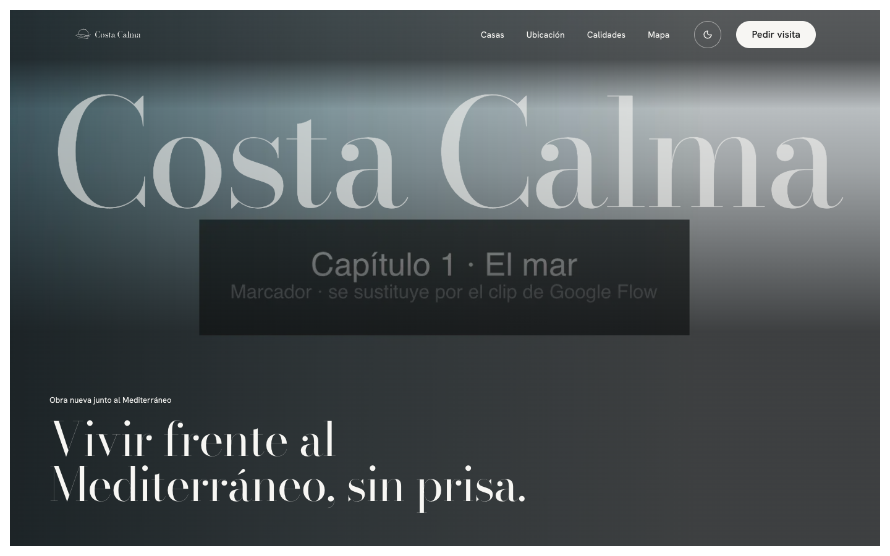             | 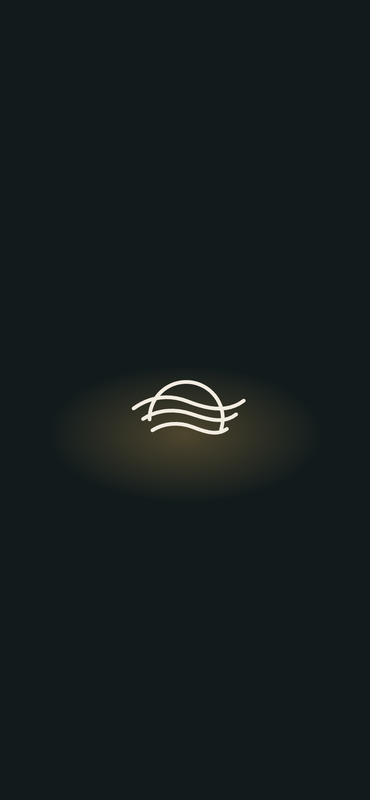 |
| 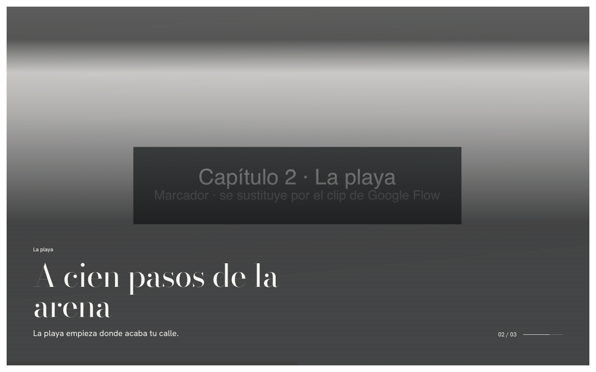 | 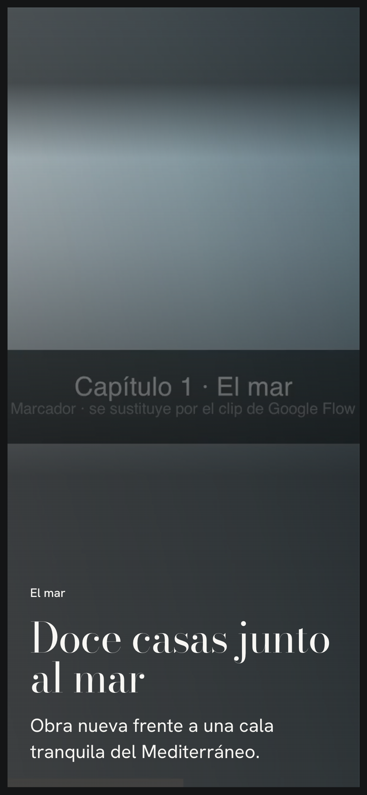         |
| 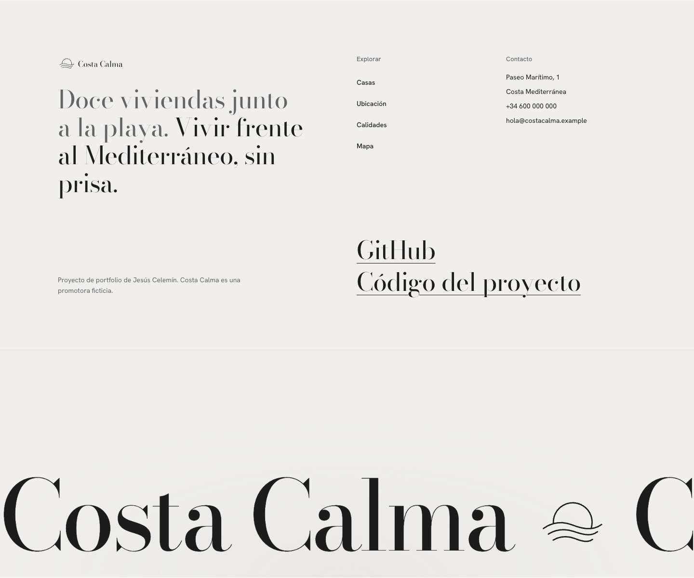         | 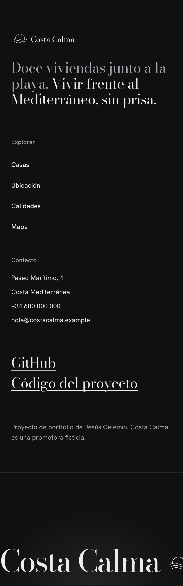              |

All captures, at 1440×900 and 390×844 in both themes, are in [`docs/screenshots/phase-2`](docs/screenshots/phase-2). The flight still runs on placeholder clips drawn from the brand palette; the Google Flow footage replaces them through the same pipeline.

### The scrub engine

The flight is driven by `useScrub` ([`src/lib/scrub`](src/lib/scrub)), an engine written for the project instead of wrapping scroll-world's `scrub-engine.js` ([ADR 0003](docs/adr/0003-own-scrub-engine.md)). It borrows scroll-world's techniques and keeps them typed and tested:

- **A pure timeline.** `timelineAt(progress, chapters, hold)` turns the section's scroll progress (0–1) into the clip time, the active chapter and how far through it the reader is. Each chapter gets a share of the scroll as long as its share of the clip, so the camera keeps one pace, and holds on its middle frame for part of its scroll so its text can be read. It has no DOM and is unit-tested with Vitest.
- **A seek-ready clip.** The video is fetched whole as a Blob, so seeking never waits on the network, and it is encoded with every frame a keyframe (H.264, with a VP9 WebM fallback), so any `currentTime` decodes at once. A Node pipeline (`npm run media:flight`, [docs/media/flight.md](docs/media/flight.md)) builds both formats, the stills and a Zod-validated manifest within a size budget (4 MB desktop, 2.5 MB mobile).
- **Eased scroll.** On each animation frame, while the section is on screen, the engine eases towards the real scroll position, so a jumpy wheel or trackpad still moves the camera smoothly. It skips seeks smaller than a frame, and it lands cleanly after the reader leaves.
- **CSS does the copy.** The engine only writes `--chapter-progress` and the active chapter. Each chapter's text fades and rises with pure CSS from that variable, so nothing re-renders per frame.
- **Graceful failure.** If the clip errors, does not start arriving in time, cannot be decoded, or the visitor asked for reduced motion or saves data, the clip is never used and the same scroll moves through one still per chapter with fades. Phones get their own vertical clip and a shorter flight.

The same engine will drive the room-by-room house tours in Phase 4.

### Design sources and tools

- **Jesús's references.** The [Vesper](https://www.youtube.com/watch?v=GJxchJkk4Lk) cabin demo built with scroll-world inspired the flight (a drone shot from outside into the scene, chapters with a counter, eyebrow and short title) and the giant translucent wordmark over the hero. [macnaagroup.com](https://macnaagroup.com/) inspired the type (a huge light grotesk with italic serif accent words), words rising from line masks, and the footer: the statement beside small details, underlined links and a marquee of the place name over a warm sunset glow. Both shaped patterns, never the palette: the brand tokens stay.
- **Galería blanca** ([ADR 0014](docs/adr/0014-galeria-blanca.md)): white by day and graphite by night, Bodoni Moda for the display type and Hanken Grotesk for the interface; the houses' photographs bring the colour.
- **GSAP and Lenis:** smooth scroll on GSAP's ticker, and SplitText for the word-by-word titles. The rest of the motion is CSS, including the footer's scroll-driven rise (`animation-timeline: view()`), which needs no JavaScript.
- **ffmpeg and sharp** for the media pipeline, and **Zod** for the sequence manifests.
- **Playwright and axe-core:** E2E tests for every flow. A WCAG 2.1 AA audit covers the intro, the hero, each flight chapter (with its still and with the clip), the footer and the mobile menu in both themes. There is also a full keyboard pass in both themes, with the flight on its clip and on its stills, and the review captures check for console errors, broken images and horizontal overflow.
- **Firecrawl** to capture macnaagroup.com's footer as a reference during the footer redesign.
- **ui-ux-pro-max:** final usability and accessibility review of the phase (below).

Mid-phase, Jesús replaced the logo with a single-color line drawing (a sun setting behind three waves) and made orange the action color instead of blue ([ADR 0004](docs/adr/0004-orange-action-color.md)). The Open Graph image was redrawn to match.

### Review fixes

The final review of Phase 2 found and fixed:

- The footer marquee moved on its own with no way to stop it apart from reduced motion. It now also pauses under the pointer.
- The loading intro had no accessibility audit, and the footer was audited before its statement had entered, so axe skipped the hidden text. Both now have their own audits in Día and Noche, and the intro gets the console and overflow checks too.

Reviewed and kept on purpose:

- **The marquee has no pause button.** It is decorative and hidden from assistive technology, it stops completely with reduced motion and pauses under the pointer, and it only shows at the very end of the page. A button would add a Tab stop that controls nothing a screen reader user can perceive.
- **The hero and flight images have empty `alt`.** For now they are placeholders: describing the sea and the beach would describe images that are not there. The meaning is carried by the motto and each chapter's heading. Real descriptions come with the Google Flow assets.
- **The intro holds the page for 1.2 to 2.5 s, then fades out in 0.7 s.** That is the spec: it lasts as long as the real preload, within those bounds so it is never a flash nor a long wait, it announces itself as a status ("Cargando Costa Calma…"), and it only plays once per session and only on the landing. With reduced motion it only fades, and without JavaScript it never shows.
- **The flight pins a long section.** The scroll still drives it: the flight never takes over or redirects it (Lenis only smooths the wheel, and is off with reduced motion), keyboard users get "Saltar el vuelo", and reduced motion shows the stills. Phones get a shorter flight.
- **The footer's portfolio links read "GitHub" and "Código del proyecto".** Their names say where they lead within the footer, as the spec asks.

## Phase 3: choosing a house and walking through it

The second stretch: the house types after the flight (lit under the pointer on a desktop, a centred carousel on a phone), a shared transition from the card to each house's own page, and a way back that lands exactly where the visitor left. Each house page is one full-screen 3D scene that starts as an architect's plan on paper, rises into a model, walks in through the front door and ends with the whole house and its floors, every room enterable and furnished. Villa Duna Blanca, Casa Pinar and Casa Olivo all run on the same engine.

| Desktop · Día                                                                             | Mobile · Noche                                                                                 |
| ----------------------------------------------------------------------------------------- | ---------------------------------------------------------------------------------------------- |
| 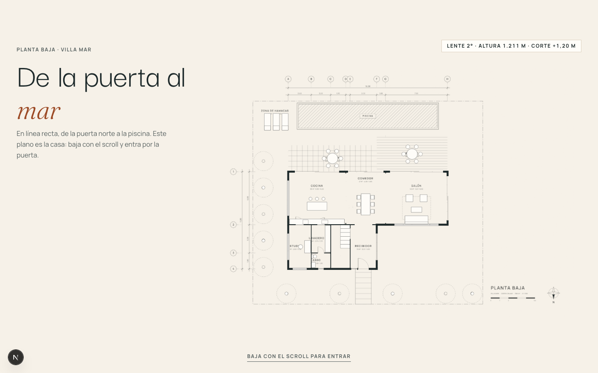         | 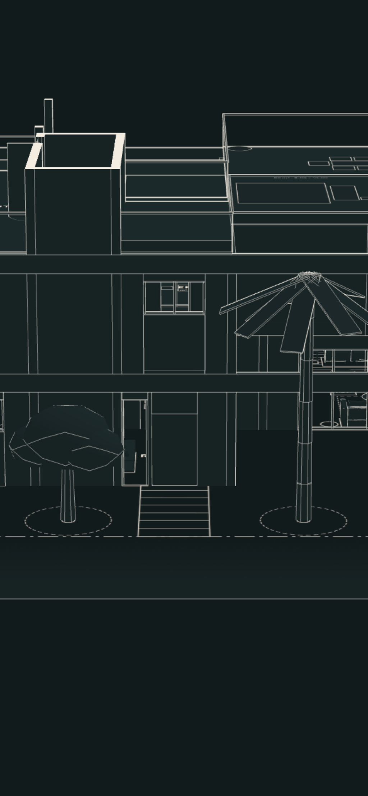          |
| 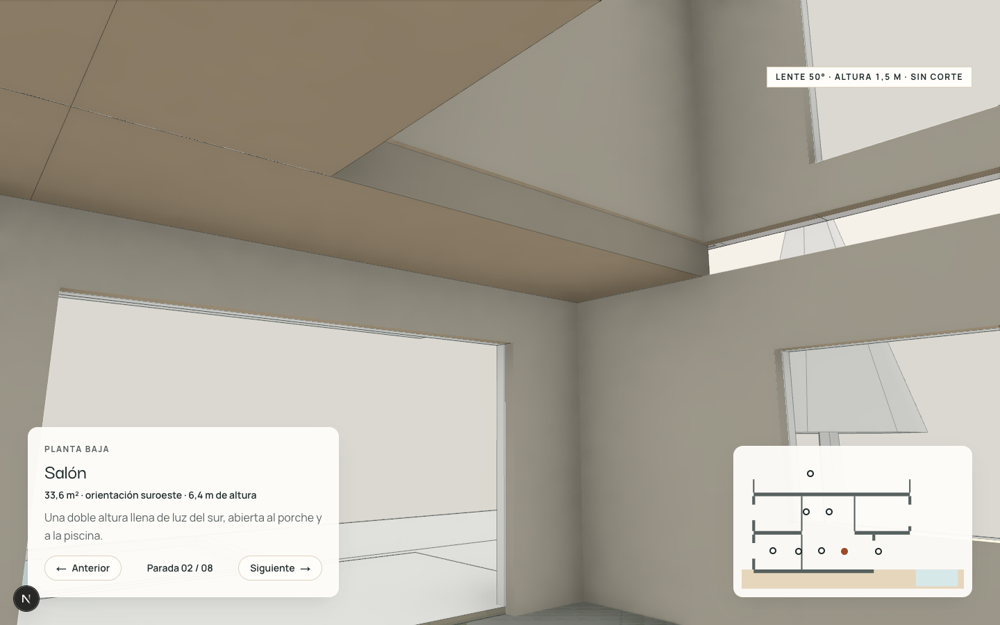    | 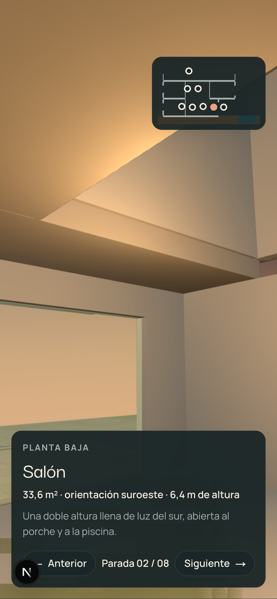        |
| 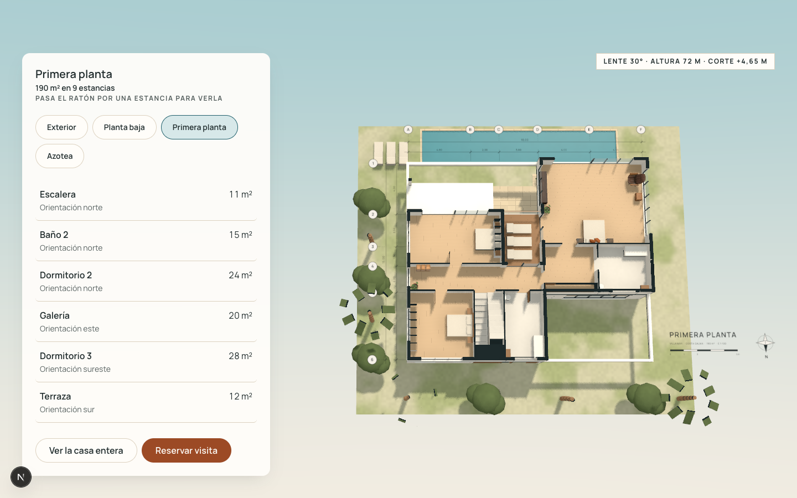            | 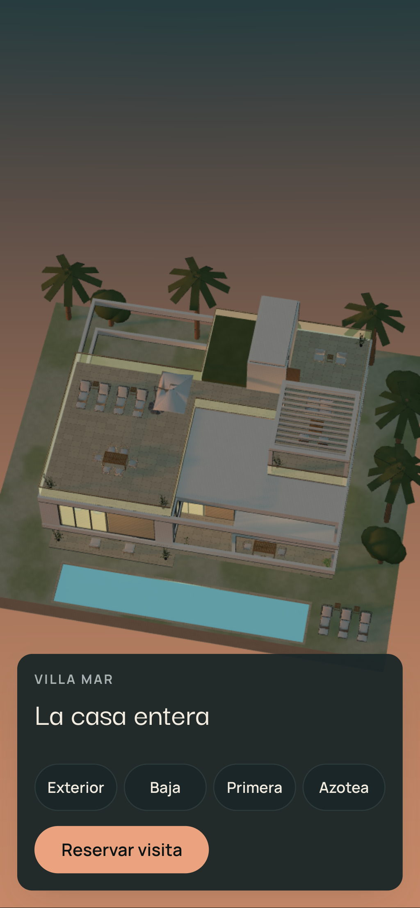       |
| 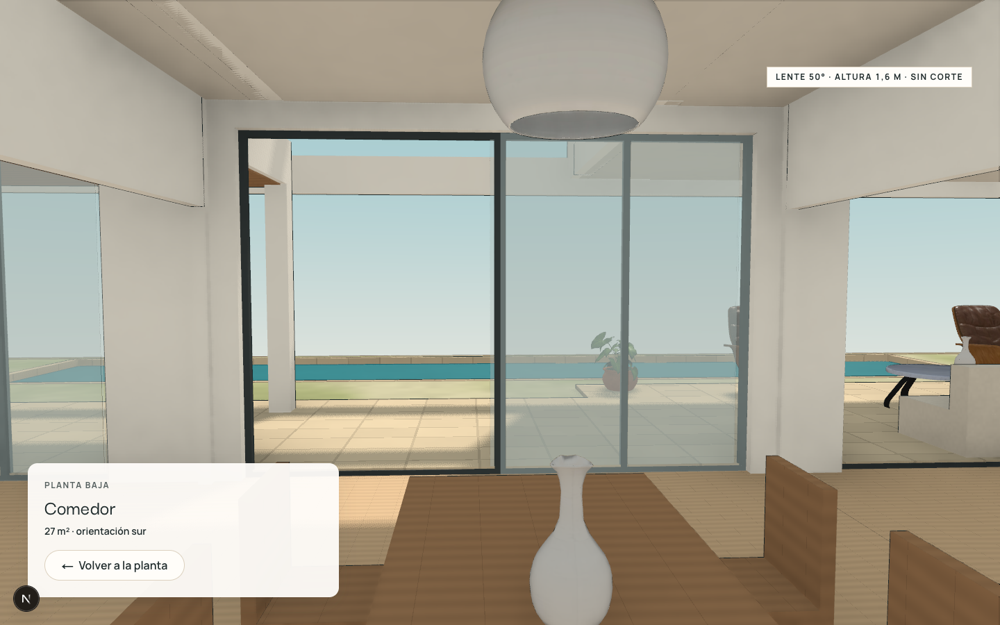 | 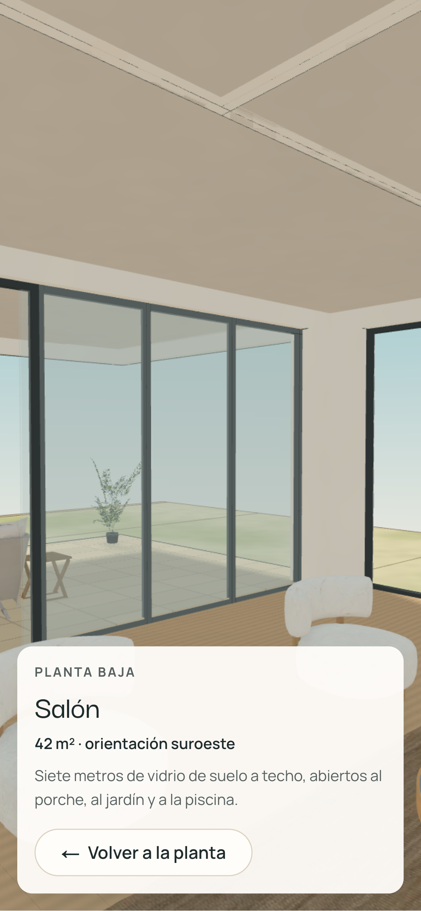 |

All captures, every phase, stop, floor and room at 1440×900 and 390×844 in both themes, are in [`docs/screenshots/phase-3`](docs/screenshots/phase-3).

### The model, from the plan

Everything on a house page comes from one typed plan per house ([`src/features/houses/plans`](src/features/houses/plans)): rooms as rectangles in metres, every door, window and sliding door declared on its wall, canopies, trees, wardrobes and the furniture placed piece by piece ([ADR 0006](docs/adr/0006-procedural-house-model.md), [ADR 0008](docs/adr/0008-free-form-storeys.md)). A validator checks what makes the architecture believable: storeys resting on the one below, double heights over the right rooms, furniture inside its room, clear of every doorway and of each other. From that one source come:

- **The sheet.** The ground floor drawn as an architect's plan in ink (grid bubbles, dimension chains, room names with their m² and sizes, furniture in plan, door swings, a title block with scale and north), as SVG for the poster and the fallback, and as the model's own first frame.
- **The model.** Walls with their openings cut out, slabs, joinery, water and terrain built in React Three Fiber, merged by material, in code-made materials with no photographic textures ([ADR 0011](docs/adr/0011-textured-furniture.md)). A **cut height** clips every storey, which is how the sheet rises into walls.
- **The sweep.** A shader keeps each material as paper and ink until the camera crosses its room's threshold, then turns it into materials and Mediterranean light: noon in Día, dusk with the lights on in Noche ([ADR 0010](docs/adr/0010-enter-from-the-plan.md)).
- **The tour.** The camera starts over the sheet with a 2° lens, tilts and descends while the lens opens (lens and distance on a log scale, so the framing never jumps), lands at eye height before the front door and walks in. Routes are computed from the plan: the camera walks straight, only through openings, round the furniture, turns only while standing, at a constant pace. Each stop has a cartela (a live region), a locator with the floor in miniature, and «Lente · Altura · Corte» in a HUD.
- **The floors and rooms.** At the end the floors above lift away, the picked one is drawn as a plan and swept into 3D, and any room can be entered at eye height, by pointer, by touch (first tap lights it, second goes in) or from a keyboard list.

Scroll drives it all as pure functions of progress (`model-choreography`, `tour-route`, `plan-sheet`), unit-tested with Vitest, so scrolling back unwinds the same path.

### The furniture

The rooms are furnished with IKEA's own 3D models (linen sofas, bouclé and rattan chairs, oak and walnut tables, upholstered beds, jute rugs, lamps, plants and outdoor pieces), for this demonstration only: the site sells nothing, never names a product, and the models stay out of the repository and are served from Vercel Blob ([ADR 0012](docs/adr/0012-ikea-furniture-for-the-demo.md), [credits](docs/credits.md)). A Node pipeline (`npm run media:furniture`) downloads them through the API of the IKEA Browser add-on for Blender, decodes their Draco, simplifies only what is woven, draws a pendant's cord in, makes the bare beds up with a mattress and bedding, and writes a desktop and a phone `.glb` per piece with a Zod-checked manifest. Each floor's pieces load only once that floor is about to be seen, after the first paint.

### Design sources and tools

- **References.** The «Section Sweep» demo by Flat to 3D (an architect's drawing that comes to colour and is walked through) set the idea, and [Casa Larga](https://sam1983aing.github.io/casa-larga/) the entrance: the plan seen from above, walls rising, the descent to the door.
- **React Three Fiber, drei and Three.js** for the model, with custom shader chunks for the sweep, **GSAP and Lenis** for the scroll, and React's **`<ViewTransition>`** for the card-to-hero transition ([ADR 0005](docs/adr/0005-view-transitions-shared-transition.md)).
- **Blender** in the background, to render each furniture piece and check its front, its look and its simplification, and **gltf-transform, meshoptimizer and sharp** in the furniture pipeline.
- **ui-ux-pro-max** for the final review (below).
- **Playwright and axe-core:** E2E tests of every phase, stop, floor and room of the three houses, keyboard and reduced-motion runs, a no-WebGL run, and captures at both sizes in both themes.

### Review fixes

The final review of Phase 3 (keyboard, accessibility tree, reduced motion, no WebGL, both themes, both sizes; ui-ux-pro-max checks for focus not obscured, target size, scroll effects and canvas semantics) found and fixed:

- IKEA's thin surfaces are two layers back to back, which drawn double-sided fought in stripes on lampshades and the parasol. Each piece now keeps the sides its glTF declares.
- Rugs sank under the floor, whose depth wins over the furniture's slight offset. Flat pieces are lifted a centimetre.
- The rattan bench at the foot of Dormitorio 2's bed showed as a black patch from the room's viewpoint; it is a pouf now.
- The captures were taken against the dev server, whose indicator («Compiling…») could cover a phone's cartela. `npm run screenshots` now takes them against a production build.

Reviewed and kept on purpose:

- **The canvas is `aria-hidden`.** Everything it shows reaches a screen reader as text: the labelled region, a description of the plan with every room and its m², the cartela as a live region, the tour's navigation and the floors' room lists.
- **The model's controls only exist in their phase.** At the sheet there is nothing to press, so Tab goes from «Saltar la maqueta» straight past the scene; in the tour come «Anterior», «Siguiente», «Más sobre la estancia» and, on a phone, «Plano» (with `aria-expanded`); at the end the floors and «Reservar visita». Every control is at least 44×44 px with a visible ring, and entering a room puts focus on «← Volver a la planta», Escape returning it to the room in the list.
- **The scroll drives a long pinned section.** It never takes over the scroll: the arrow keys and buttons move between stops, «Saltar la maqueta» skips it, and with reduced motion the tour fades from the sheet to each stop with no descent, camera flight or sweep.
- **The furniture weighs about 12.5 MB on a desktop and 10 MB on a phone.** It loads floor by floor after the first paint; KTX2 textures are the next step if the phone's memory asks for it, in Phase 6.

## Redesign: Galería blanca

Once the houses became luxury villas, the warm palette (terracotta, sand, sun) no longer fit them. Out of three directions, Jesús chose **Galería blanca** ([ADR 0014](docs/adr/0014-galeria-blanca.md)) after seeing an animated mock. The page is white by day and graphite by night. Display type is Bodoni Moda, the interface is Hanken Grotesk, and the photographs supply the colour. The redesign shipped as seven tickets (#67 to #74), each a commit of its own.

| Desktop                                                                       | Mobile                                                                                      |
| ----------------------------------------------------------------------------- | ------------------------------------------------------------------------------------------- |
|                | 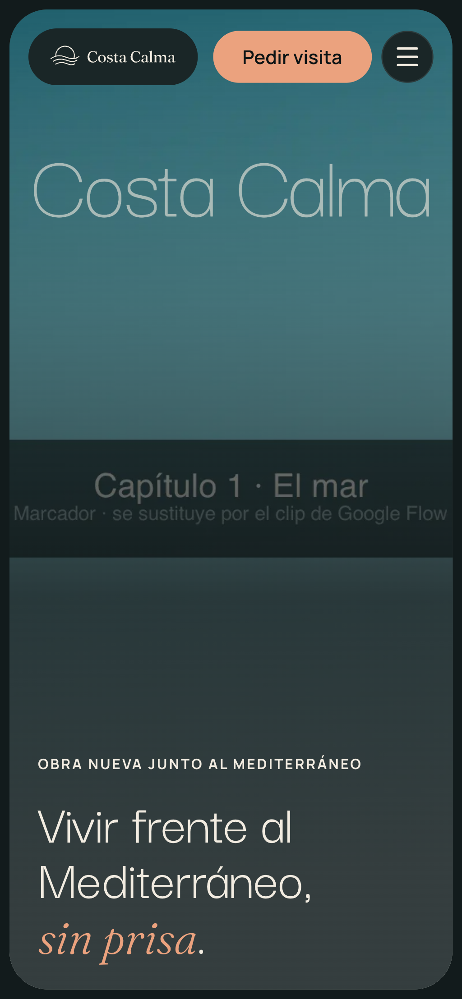                             |
| 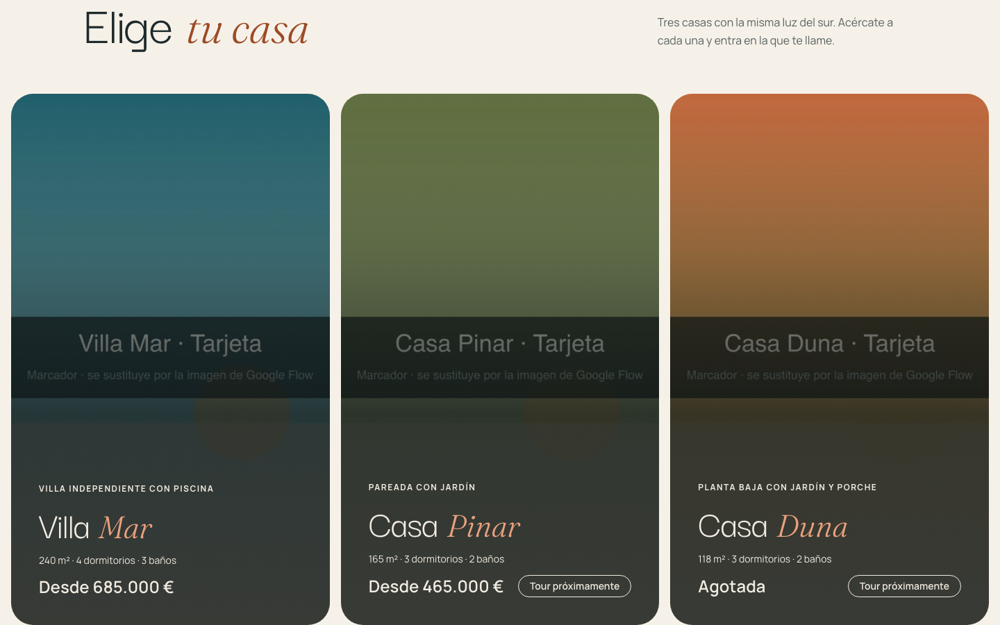 | 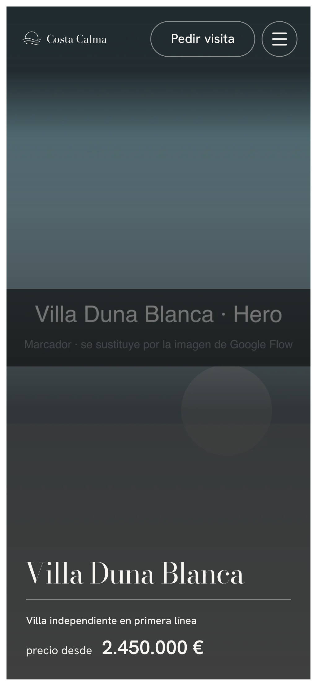 |
| 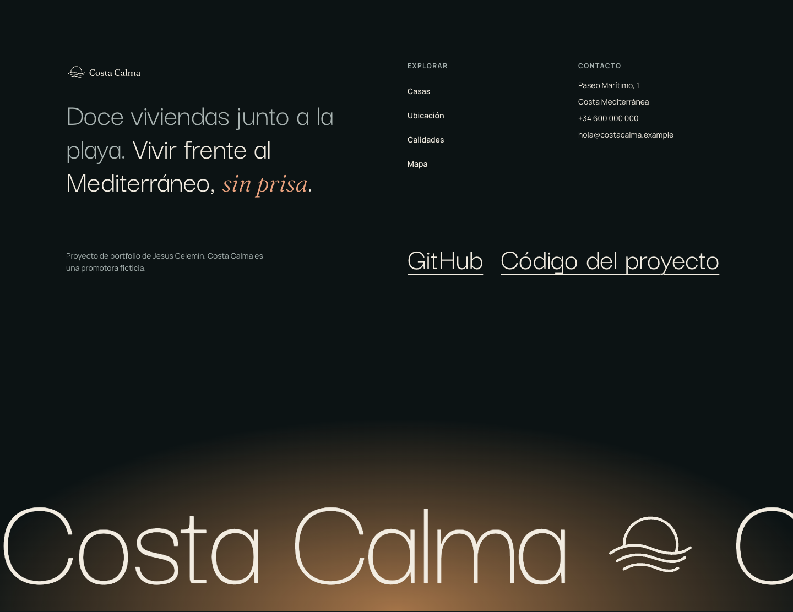         | 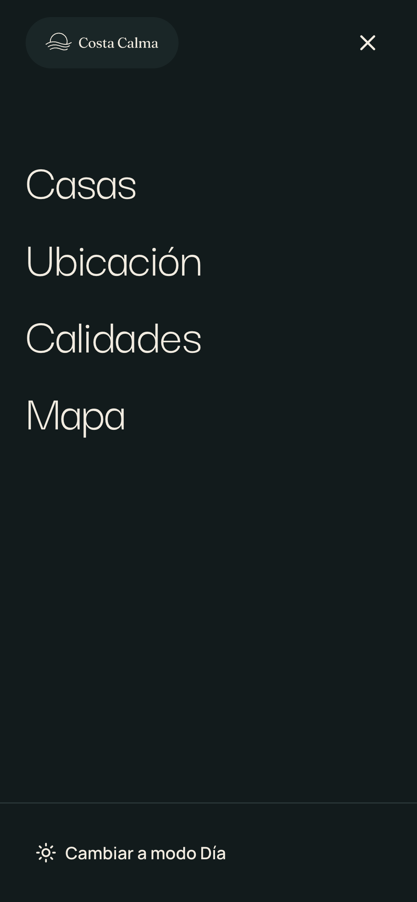                              |

- **The brand.** The logo keeps its sun and three waves at a finer stroke, with "Costa Calma" outlined from Bodoni Moda. There is a single primary button, a black pill (white in Noche), with an outline button as its quieter partner. Photographs are no longer rounded. Accent words in coloured italics and all-caps labels are gone.
- **The header** lies on the hero and the flight in light text, with no pills. A graphite scrim at the top of the frame keeps its links at 4.5:1 even over a white sky. Once past the media, the header turns solid.
- **Motion** (`components/ui`): titles rise line by line. Images open from the bottom while settling from a slow zoom (up to 1.2 s). Text fades in, figures count up, and blinds open over an image. Each piece is marked in view by a single observer that stops once it fires, and CSS does the motion. Their timing lives in pure, tested functions (`lib/reveal.ts`). With reduced motion or no scripting everything stays still and visible, and a CSS fallback shows them if the client never takes over.
- **The landing.** The giant "Costa Calma" retreats on a CSS scroll timeline. The flight names the houses, ending on «Elegir casa», with a counter and a line for its progress. A phrase with the houses' photographs inline tints word by word with the scroll, and the house type cards open as they come into view.
- **The house page.** The giant name sits over the photograph with the house's kind and starting price. Its figures count up, and the walk's four stages sit beside the sheet. A staggered gallery, one floor behind blinds, and «Ven a verla» close the page.
- **Social images and the home-screen icon** are drawn in code (`ImageResponse`) from the logo's own paths and static Bodoni and Hanken TTFs.

### Design sources and tools

- **Jesús's references:** [era-residence.com](https://www.era-residence.com/), [stillform.homes](https://stillform.homes/), [elyse-residence](https://elyse-residence-dev.webflow.io/), [normalisboring.es](https://normalisboring.es/) and [emaratrealty.com](https://www.emaratrealty.com/). From them came the giant name over the opening shot, the tinting phrase with inline photographs, line-by-line titles, images that open and settle, the hover-lit cards, counting figures and the blinds.
- **frontend-design** for the three directions and the animated mock. **ui-ux-pro-max** for the final review below.
- **fontTools and HarfBuzz** to outline the wordmark from Bodoni Moda with its kerning, and to cut static instances for the Open Graph renderer.
- **Playwright and axe-core** for the E2E suite and the captures, and **Vitest** for the motion timing and the scrim contrast.

### Review fixes

- Over a white sky, the header's light links reached only about 3.6:1 on the first top scrim. Its upper half is now dense enough for 4.5:1, which a token test checks.
- On a phone, the house figures' tabular digits pushed «1.008,5 m²» 4 px past the screen. They use proportional digits again.
- In the carousel, a card peeking from the side waited as an empty frame. Images now open as soon as an edge shows.
- Back from the house types, the "Casas" anchor left the section 1 px under the header's border. The scroll margin now includes that border.
